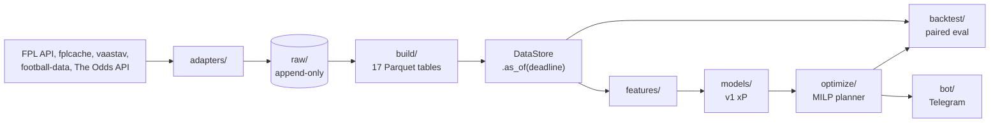

# fpl-optimizer

[](https://github.com/samintisar/fpl-optimizer/actions/workflows/ci.yml)

[](https://docs.astral.sh/uv/)
[](https://docs.astral.sh/ruff/)
[](LICENSE)

A Fantasy Premier League decision engine. It recommends transfers, captain and bench order to
maximize **expected total points**, and delivers them through a Telegram bot before every
deadline. It recommends; you decide.

Most FPL tools give you a points projection and a solver. This project spends most of its effort on
the part they skip: **proving the recommendations are actually better**, using a backtest that can't
see the future and statistics that can't be fooled by one lucky season.

> **Status:** Phases 0–6 of 9 (numbered 0–8) are done. On the untouched 2025/26 season, in one
> pre-registered run, the system beat both baselines and passed its go-live gate
> ([results](#results)). The Telegram bot (Phase 7) is built and goes live once its live checks
> pass. Chips are still played manually.

## Highlights

- **Passed a pre-registered holdout test.** The test, threshold, baselines and every setting were
  fixed in code before the 2025/26 season was ever scored, and the run refuses to execute twice
  or from an untagged or modified checkout.
- **Point-in-time data, enforced.** Every derived row carries `event_time` and `available_at`.
  Features, models and the backtester read only through `DataStore(...).as_of(deadline)`, which
  keeps rows with `available_at < deadline`. A static architecture test stops feature and model
  code from reading files or keeping state any other way.
- **Corrupt-the-future leakage check.** Randomize or truncate every row after a deadline, refit and
  recompute every feature, model and decision, and require byte-identical output. Runs in CI on
  synthetic data and on the real warehouse at known edge cases (season starts, COVID-era GW39–47,
  GW18 of 2021/22 with 6 of 10 fixtures postponed).
- **Market where it's strong, structure elsewhere.** Team goal rates come from bookmaker odds
  (de-vigged 1X2 and over/under fitted to a Dixon-Coles model), carried beyond the odds horizon by
  attack/defence ratings with priors from our own Elo. Player goal and assist shares use
  empirical-Bayes shrinkage, and minutes come from a deterministic LightGBM hurdle model with
  injury-flag and ban adjustments. Every model is refit walk-forward and covered by the leakage
  check.
- **A real optimizer.** A multi-gameweek MILP (PuLP + HiGHS) plans transfers, captaincy, bench order
  and chips over 6 GWs and returns the top 3 plans plus a "roll" baseline. Bench slots are weighted
  by the minutes model's chance that each one is needed, following FPL's autosub order. On 24 real
  instances it reaches the same optimum as
  [open-fpl-solver](https://github.com/solioanalytics/open-fpl-solver).
- **Honest evaluation.** Season totals swing ±80–100 points on luck alone, so policies are compared
  only in **paired** runs from identical start states, per decision and over full seasons, with
  block-bootstrap CIs, season-level t-tests and a best-of-N deflation for every variant tried. Test
  sizes were measured by A/A placebo simulation, which is why the holdout gate uses a t-test
  rather than the bootstrap.
- **Negative results kept.** Two pre-registered checks failed and are reported as failed: the
  optimizer's edge over greedy with baseline xP (Phase 4) and with the new model on the validation
  seasons (Phase 5, positive but under-powered). Neither was re-run until it passed.
- **Plans from your real team.** `--entry TEAM_ID` imports a squad, purchase prices, bank, free
  transfers and chips from FPL's public API; a TOML squad file can override any of it.
- **Production ops on a home server.** systemd timers archive the FPL API and bookmaker odds daily
  and before each deadline, rebuild the plan context when new data lands, and send each user's
  recommendation 24 hours before the deadline. A freshness check, a dead-man's-switch heartbeat and
  Telegram alerts catch silent failures.

## Results

Splits: develop 2016/17–2022/23 (tuning), validate 2023/24–2024/25 (confirmation), holdout 2025/26
(scored once). Every run is logged with its git sha, config and variant count in
[`results/experiments.csv`](results/experiments.csv), and the full analysis is in
[`docs/PLAN.md`](docs/PLAN.md).

### Holdout: 2025/26, one pre-registered run (Phase 6)

The system is the `v1` model with the MILP optimizer (6-GW horizon, decay 0.75, at most one hit),
no chips. It is compared per decision: from the same squad state, each arm makes its own moves
for 4 gameweeks, over the season's 10 non-overlapping windows. Start states are a template squad
and 3 random squads at GW1, and 3 random squads at GW20.

| System vs | Per 4-GW window (one-sided t-test p) | xG-scored | Full run, pts/GW (80% CI) | Gate |
|---|---|---|---|---|
| Rolling-average xP + greedy transfers | **+16.7** (p 0.036) | +18.9 | +6.6 (+4.1 to +9.0) | ✅ Pass |
| FPL's `ep_next` + the same optimizer | **+30.3** (p < 0.001) | +20.5 | +7.8 (+4.8 to +10.6) | ✅ Pass |

Season totals from GW1 (mean of 4 starts): **2,240** for the system (2,317 from the template
squad), 1,980 for greedy on rolling xP, 1,911 for the optimizer on `ep_next`. Caveats: this is one
season, and the `ep_next` arm over-trades (114 hit points per season, because FPL's one-GW
projection is copied across the 6-GW horizon), so its margin overstates the model-versus-FPL edge.

### xP model: validate, one run (Phase 5)

Walk-forward predictions at every deadline of 2023/24–2024/25, after all tuning was done on
develop. MSE is per player-GW. Regrets are points lost per GW against the best captain or XI in
hindsight, over a template and 3 random squads.

| Model | MSE, next GW | MSE, GW+1 to +5 | Candidate MSE | XI regret | Captain regret |
|---|---|---|---|---|---|
| **`v1`** (this project) | **3.47** | **3.98** | **8.79** | **4.60** | **4.04** |
| Rolling average | 4.35 | 4.80 | 11.20 | 5.29 | 4.63 |
| FPL's own `ep_next` | 4.46 | 5.24 | 11.31 | 4.68 | 4.11 |

`v1`'s MSE is 17–24% lower than both baselines' (one-sided Diebold-Mariano p < 0.001 at every
horizon). It wins both validation seasons and is calibrated in every predicted-xP band, while the
baselines overpredict above ~3 xP.

### Decision policies (Phases 3–5)

Paired backtests, 80% two-sided CIs (the lower bound is the one-sided α = 0.10 test).

| Comparison | Seasons | Full run, pts/GW (80% CI) | Per 4-GW window |
|---|---|---|---|
| Greedy transfers vs never transferring, rolling xP | 2016/17–2024/25 | **+11.4** (+10.4 to +12.6) | +9.3 (+7.6 to +11.1) |
| Greedy on FPL's `ep_next` vs greedy on rolling xP | 2021/22–2024/25 | −0.6 (−1.8 to +0.5) | −0.5 (−3.2 to +2.6) |
| Optimizer vs greedy, rolling xP (Phase 4) | validate | −0.03 (−0.95 to +0.88) ❌ | — |
| Optimizer vs greedy, `v1` xP (Phase 5) | validate | +0.74 (−0.85 to +2.37) ❌ | +7.3 (+3.4 to +11.6) |

With baseline xP the optimizer realizes only about a fifth of the transfer gain it predicts (the
optimizer's curse). With `v1` the slope of realized on predicted gain is about 1, so a hit can pay
and the optimizer is allowed one. Its full-run edge was positive in both validate seasons but too
small to clear the pre-registered bar on two seasons, so the question went to the holdout above,
which uses the per-decision test.

## How it works



1. **Ingest.** Thin, project-owned adapters for each source write gzipped, timestamped responses to
   `raw/`. One-off backfills pull 10 seasons of history (about 1 GB, mostly fplcache).
2. **Build.** `fplopt build all` turns `raw/` into 17 Parquet tables (players, fixtures, per-GW and
   per-match stats, snapshots, odds, Elo ratings) in about 90 seconds. Players are keyed on a stable
   `player_key` across seasons (FPL ids reset every year) and mapped to Understat by per-fixture
   minutes and fuzzy names, with validation that every player with minutes maps.
3. **Point in time.** `DataStore(data_dir).as_of(deadline)` is the only way features, models and
   the backtester see data. Each table kind (static, schedule, event, snapshot) has its own
   visibility rule, documented in [`docs/PLAN.md` §4](docs/PLAN.md#4-leakage-prevention).
4. **Model.** `v1` builds expected points per player and GW from components: market-implied team
   goal rates, player goal and assist shares and penalties, a minutes model (P(start), P(60+), sub
   minutes), clean sheets, saves, bonus, defensive contributions, cards and goals conceded, with
   isotonic calibration of P(start). It is refit every 4 GWs on the data visible at that point and
   keeps its components, not just the total.
5. **Optimize.** The MILP plans 6 GWs ahead under FPL's real constraints (budget with selling
   prices, free-transfer banking, club limits, formations, minutes-weighted bench, chip windows),
   prunes the player pool (at most 0.21 points lost on 40 real benchmark cases), and executes only
   this GW's moves before re-solving next week.
6. **Backtest.** The simulator replays a season from any squad state (squad, purchase prices, bank,
   free transfers, chips) under FPL's rules: selling prices, autosubs, captaincy, FT banking, hits.
   Policies (roll, greedy, optimizer) are pluggable and run in parallel over seasons and start
   states.
7. **Deliver.** When new data lands, a timer job rebuilds one shared **plan context** (the `v1` xP
   for the next deadline). Each registered user's plan is an import of their team plus one solve on
   that context. The bot sends it 24 hours before the deadline and again after the final
   pre-deadline snapshot, but only if the plan changed.

The full design, including every data-source caveat and decision, is in
[`docs/PLAN.md`](docs/PLAN.md). Model tuning scripts and their results are in
[`dev/`](dev/README.md).

## Quickstart

Requires [uv](https://docs.astral.sh/uv/) and Python 3.12.

```bash
git clone https://github.com/samintisar/fpl-optimizer.git
cd fpl-optimizer
uv sync --all-extras
uv run pytest            # ~1,450 tests on synthetic data, no network needed
```

To work with real data, backfill history into `raw/` (about 1 GB, 20–30 minutes in total) and
build the tables:

```bash
uv run fplopt backfill football-data
uv run fplopt backfill vaastav
uv run fplopt backfill fplcache
uv run fplopt build all
```

Then compare two policies, or see the system's plans at a past deadline:

```bash
uv run fplopt backtest compare --a greedy:rolling --b roll:rolling --seasons 2021-2024
uv run fplopt optimize plan --season 2024 --gw 10 --xp v1 --decay 0.75 --max-hits 1 --hit-margin 2 --no-chips
```

The plan uses the live system's settings and takes about 2 minutes, most of it fitting `v1` at
that deadline. Drop `--no-chips` to let it plan chips too, or add `--entry TEAM_ID` to plan for a
real FPL team instead of the template squad.
Running the archiver, alerts and bot on a server is covered in
[`deploy/README.md`](deploy/README.md).

### CLI

| Command | What it does |
|---|---|
| `fplopt snapshot daily` / `tick` | Archive FPL, odds and football-data snapshots (the server's timers run these) |
| `fplopt backfill football-data\|vaastav\|fplcache\|element-summary` | One-off historical backfills into `raw/` |
| `fplopt build all` / `build <table>` | Rebuild `data/*.parquet` from `raw/` |
| `fplopt rules export <season>` | Write the season's scoring rules config from an archived bootstrap |
| `fplopt check freshness` | Fail and alert if the newest snapshot is missing or stale |
| `fplopt check leakage` | Corrupt-the-future check of every feature, model and decision probe on real data |
| `fplopt models eval` | Walk-forward xP evaluation: MSE by horizon and xP band, captain/XI regret, Diebold-Mariano tests |
| `fplopt backtest run` | Replay one policy over seasons × start states; prints totals and captain/XI regret |
| `fplopt backtest compare` | Paired comparison of two policies with bootstrap CIs, realized and xG-scored |
| `fplopt optimize plan` | Top-3 plans plus the roll plan from a template, random or real (`--entry`) squad |
| `fplopt optimize squad` | Write an imported FPL team as a squad file to check or edit |
| `fplopt optimize bench` | Optimizer solve-time and pruning benchmark on real deadlines |
| `fplopt holdout check` / `run` | Check the 2025/26 inputs; the one-shot pre-registered Phase 6 run |
| `fplopt live prepare` / `tick` | Build the plan context; the 15-minute deadline-alert job |
| `fplopt bot run` | The Telegram bot (long polling) |

Policy specs are `name:xp[:key=value,...]`, e.g. `greedy:rolling:threshold=2.0`, `roll:ep_next` or
`optimizer:v1:horizon=6,decay=0.75,max_hits=1,hit_margin=2` (the live system). Every `run`,
`compare`, `models eval` and holdout run appends a row (git sha, config, metrics, variant count) to
`results/experiments.csv`. Backtests and evaluations run in parallel with `--jobs N`. Run
`fplopt <group> --help` for all options.

### Telegram bot

Access is invite-only: the admin approves each chat. Users `/register` their FPL team ID, then
get `/plan` on demand and the alerts automatically; `/setft` corrects the free-transfer count and
`/alerts` turns alerts on or off. The admin has `/allow`, `/block` and `/users`.

### Environment variables

Needed for the archiver, alerts and bot. Put them in a local `.env` (gitignored) or set them on the
server.

| Variable | Purpose |
|---|---|
| `TELEGRAM_BOT_TOKEN` | Bot token from @BotFather (the bot and failure alerts) |
| `TELEGRAM_ADMIN_CHAT_ID` | The admin chat: pipeline-failure alerts and bot access requests |
| `ODDS_API_KEY` | The Odds API key (optional; odds are skipped without it) |
| `HEALTHCHECK_PING_URL` | Optional. Pinged after each successful `snapshot daily`/`tick`, for an external dead-man's switch such as healthchecks.io. Treated as a secret: never logged |
| `FPLOPT_RAW_DIR` | Raw snapshot root (default `raw`) |
| `FPLOPT_DATA_DIR` | Parquet root (default `data`) |
| `FPLOPT_STATE_DIR` | Bot state: `bot.sqlite` (users, settings, every recommendation) and plan contexts (default `state`) |

## Roadmap

| # | Phase | Status |
|---|---|---|
| 0 | Snapshot archiver | ✅ Running on the server |
| 1 | Backfill + ID mapping + Parquet tables | ✅ 10 seasons, 17 tables, one-command rebuild |
| 2 | `as_of` layer + leakage tests | ✅ In CI and `fplopt check leakage` |
| 3 | Backtester + baselines + greedy policy | ✅ Paired full-run and per-decision evaluation |
| 4 | MILP optimizer (transfers, captain, bench, chips, top-3 plans) | ✅ Matches open-fpl-solver |
| 5 | Real models (market-implied team model, shares, minutes, calibration) | ✅ `v1` beats both baselines on validate; optimizer-vs-greedy not met as pre-registered, sent to the holdout |
| 6 | Holdout evaluation on 2025/26 (single, pre-registered run) | ✅ Passes the go-live gate against both baselines |
| 7 | Telegram bot + go live | 🔄 Built (`/register`, `/plan`, alerts); live once its checks pass |
| 8 | Distributions, sensitivity analysis, uncertain fixtures, chip timing, live findings | Next |

Progress is tracked as GitHub milestones (one per phase) and issues.

## Repository layout

```
src/fplopt/
  adapters/   one module per data source (fpl, odds, football_data, vaastav, fplcache)
  ingest/     raw snapshot writers (daily/tick jobs), one-off historical backfills
  build/      raw -> Parquet tables (`fplopt build all`), ID mapping, Elo, rules export
  features/   point-in-time feature builders (each takes one as-of view) + leakage check
  models/     xP models: baselines and v1 (team, shares, minutes, availability, calibration)
  evaluate/   walk-forward xP metrics (`fplopt models eval`)
  optimize/   MILP planner: model, pruning, chip search, top-k plans, bench weights, benchmark
  backtest/   simulator, FPL rules and scoring, policies, paired evaluation, the holdout run
  bot/        Telegram bot, plan contexts, deadline alerts, SQLite user state
  entry.py    import a real FPL team (squad, prices, bank, free transfers, chips)
config/       scoring rules per season, teams.csv (club names per source), overrides.csv
deploy/       systemd units + server runbook
dev/          model-tuning and reference-check scripts (not in the package) and their results
docs/PLAN.md  design doc and decision log (source of truth)
results/      experiments.csv (tracked); run outputs (gitignored)
tests/        unit, architecture and leakage tests; `-m realdata` runs on the real warehouse
raw/, data/   (gitignored) immutable snapshots; Parquet tables
state/        (gitignored) bot database and plan contexts
```

## Ground rules

- `raw/` is append-only. Everything downstream rebuilds from it: fix the code and rebuild, never
  patch data.
- Every derived row carries `event_time` and `available_at`. Features, models and backtests read
  only through `as_of(deadline)`.
- FPL player ids reset every season. Key on `player_key`, never the FPL id.
- Tune on component metrics (log loss, calibration, MSE), not season totals.
- The 2025/26 holdout was scored once, in Phase 6. Nothing is tuned on it.
- Everything user-facing is keyed by `user_id`. Secrets live in `.env` or server env vars, never
  in the repo.

## Contributing

Issues and PRs are welcome. Before opening a PR:

```bash
uv run ruff check . && uv run ruff format --check .
uv run pytest
```

Read the relevant section of [`docs/PLAN.md`](docs/PLAN.md) before building a component. Changes
that touch features or models should keep `fplopt check leakage` passing.

## Data sources and acknowledgements

- [Fantasy Premier League](https://fantasy.premierleague.com/) public API: live snapshots and team
  imports.
- [Randdalf/fplcache](https://github.com/Randdalf/fplcache) (public domain): historical
  `bootstrap-static` snapshots from April 2021.
- [vaastav/Fantasy-Premier-League](https://github.com/vaastav/Fantasy-Premier-League): per-GW
  history from 2016/17, including its Understat mirror. This project never requests Understat
  directly.
- [football-data.co.uk](https://www.football-data.co.uk/): results and pre-match odds.
- [The Odds API](https://the-odds-api.com/): live odds.
- [open-fpl-solver](https://github.com/solioanalytics/open-fpl-solver) (Apache-2.0): the
  reference the optimizer is checked against (same optimum on 24 real instances). Its code is
  never vendored or copied.
- [FPL-Core-Insights](https://github.com/olbauday/FPL-Core-Insights): research use only, to set
  the defensive-contribution prior once. It is never committed, shipped or needed at runtime.

Each source has its own terms. Raw snapshots and the Parquet tables built from them are not
redistributed in this repository. The only data file tracked is
[`results/experiments.csv`](results/experiments.csv), a log of this project's aggregate backtest
metrics (season totals, paired differences, CIs) that contains no source records.

## License

The code is released under the [MIT License](LICENSE), which also covers
`results/experiments.csv`. It does not cover the data the sources above provide.

This project is not affiliated with or endorsed by the Premier League or Fantasy Premier League.
